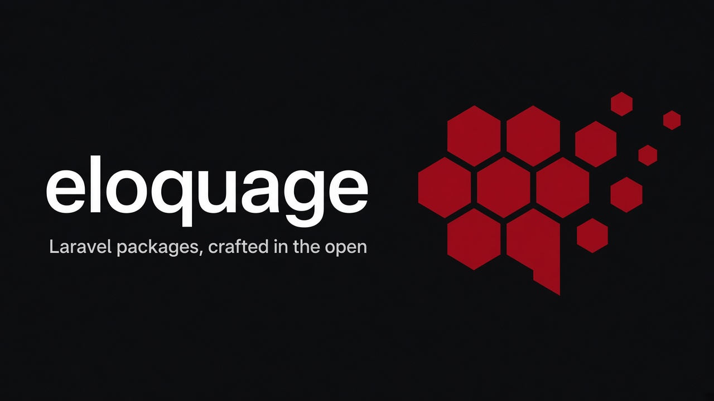

# Eloquage

**Local-first AI & search infrastructure for PHP.**

Small, sharp, composable packages — vector math, embeddings, lexical search,
tokenizers, chunking, scoring, and ONNX inference — that run in-process,
with optional native extensions when you need the speed.

---

## The PHP RAG stack

| Package | What it does |
|---|---|
| [`vector`](https://github.com/eloquage/vector) | In-process vector math: cosine, dot, L2, top-k, batch similarity |
| [`embed`](https://github.com/eloquage/embed) | Embedding helpers: normalize, chunk metadata, cache keys, provider-agnostic DTOs |
| [`beacon`](https://github.com/eloquage/beacon) | Local semantic search: store embeddings, query top-k, filter by metadata |
| [`lex`](https://github.com/eloquage/lex) | Lexical search toolkit: tokenization, n-grams, BM25, inverted indexes |
| [`tokens`](https://github.com/eloquage/tokens) | Fast tokenizers: BPE/WordPiece encode/decode, batch tokenization |
| [`chunk`](https://github.com/eloquage/chunk) | Document chunking: overlapping windows, markdown/code-aware splits, token budgets |
| [`score`](https://github.com/eloquage/score) | In-request ML scoring: exported linear/tree models for ranking & pricing |
| [`onnx`](https://github.com/eloquage/onnx) | Thin ONNX Runtime bindings — portable models, no Python sidecar |
| [`rerank`](https://github.com/eloquage/rerank) | Cross-encoder & feature-based reranking for lexical + vector pipelines |

Every package ships as a pure-PHP implementation with an optional
PIE-compatible native extension (`*-ext`) built with
[`typephp-builder`](https://github.com/eloquage/typephp-builder).

## Laravel tooling

| Package | What it does |
|---|---|
| [`docker-php`](https://github.com/eloquage/docker-php) | Docker Engine API client for Laravel with a Livewire management UI |
| [`filament-horizon`](https://github.com/eloquage/filament-horizon) | Horizon integration for Filament |

## Laravel packages

### Health checks

| Package | What it does |
|---|---|
| [`healthcheck-ai`](https://github.com/eloquage/healthcheck-ai) | AI service connectivity health check for Laravel |
| [`healthcheck-mail`](https://github.com/eloquage/healthcheck-mail) | Mail connectivity health check for Laravel |
| [`healthcheck-mercure`](https://github.com/eloquage/healthcheck-mercure) | Mercure connectivity health check for Laravel |
| [`healthcheck-migration`](https://github.com/eloquage/healthcheck-migration) | Pending database migrations health check for Laravel |
| [`healthcheck-octane`](https://github.com/eloquage/healthcheck-octane) | Laravel Octane server status health check |
| [`healthcheck-operations`](https://github.com/eloquage/healthcheck-operations) | Pending one-time operations health check for Laravel |
| [`healthcheck-pgvector`](https://github.com/eloquage/healthcheck-pgvector) | PostgreSQL pgvector connectivity health check for Laravel |
| [`healthcheck-redis`](https://github.com/eloquage/healthcheck-redis) | Redis extension and connectivity health check for Laravel |
| [`healthcheck-storage`](https://github.com/eloquage/healthcheck-storage) | Laravel storage disk writability health check |
| [`healthcheck-stripe`](https://github.com/eloquage/healthcheck-stripe) | Stripe API connectivity health check for Laravel |
| [`healthcheck-typesense`](https://github.com/eloquage/healthcheck-typesense) | Typesense connectivity health check for Laravel |

### Laravel integrations

| Package | What it does |
|---|---|
| [`laravel-content-sentinel`](https://github.com/eloquage/laravel-content-sentinel) | A configurable content safeguard and moderation pipeline for Laravel |
| [`laravel-edge-clear`](https://github.com/eloquage/laravel-edge-clear) | Standalone Cloudflare cache purging for Laravel |
| [`laravel-hybrid-search`](https://github.com/eloquage/laravel-hybrid-search) | Hybrid lexical and vector search for Laravel |
| [`laravel-llm-router`](https://github.com/eloquage/laravel-llm-router) | Route Laravel AI requests across language model providers |
| [`laravel-places-scout`](https://github.com/eloquage/laravel-places-scout) | A fluent Laravel package for the Google Places API with strongly typed DTOs |
| [`laravel-prompt-registry`](https://github.com/eloquage/laravel-prompt-registry) | Dynamic AI agent prompt registration and retrieval for Laravel |
| [`laravel-semantic-deduper`](https://github.com/eloquage/laravel-semantic-deduper) | Semantic duplicate detection for Laravel applications |
| [`laravel-social-caster`](https://github.com/eloquage/laravel-social-caster) | Publish social media content from Laravel |
| [`laravel-vault-cipher`](https://github.com/eloquage/laravel-vault-cipher) | Encrypt and decrypt application secrets with Laravel |
| [`laravel-vector-schema`](https://github.com/eloquage/laravel-vector-schema) | Define and validate vector schemas for Laravel search |
| [`laravel-wayfinder-forge`](https://github.com/eloquage/laravel-wayfinder-forge) | Generate strongly typed frontend SDKs from Laravel routes |

## License

All packages are MIT-licensed. Built by [Miguel Enes](https://github.com/miguelenes).
